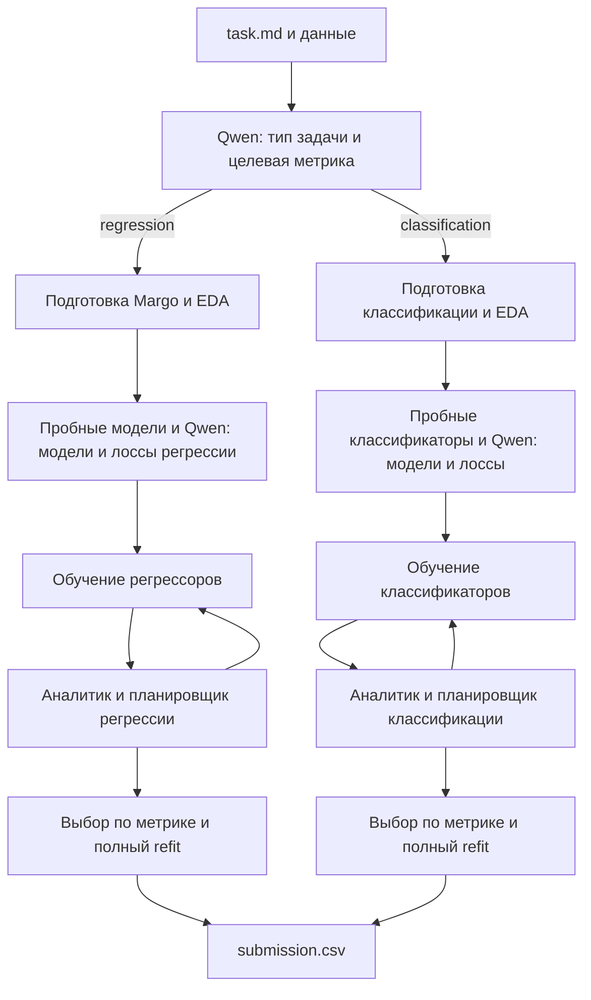

# Две линии одного решения

Единая точка входа: `python solution.py task.md`. Qwen определяет тип задачи и интерфейс по условию и заголовкам CSV. Затем `agent/platform_pipeline.py` явно выбирает одну из двух независимых линий:



Общими остаются протокол JSON, координатор таймера, аудит артефактов и интерфейс запуска. Регрессоры и классификаторы не подменяют друг друга. Первичная метрика фиксирована заданием.

Классификация выполняет подготовку и стратифицированный внешний split до EDA, короткие реальные пробы исключительно внутри outer-fit, затем отдельный вызов Qwen для выбора классификаторов и нативных функций потерь. Преобразования обучаются внутри каждого fold. Аналитик получает метрики и диагностику отдельных классов; планировщик меняет параметры выбранных моделей. Таймер и детерминированный координатор сохраняют лучшую модель и резерв времени для полного refit.

Поддерживаются бинарные и многоклассовые метки. Метрики: accuracy, balanced_accuracy, f1_macro, f1_weighted, binary f1, roc_auc и log_loss. Для log_loss направление — минимум, для остальных — максимум. Столбцы predict_proba выравниваются по зафиксированному порядку классов. CSV может содержать исходные метки или один столбец вероятности положительного класса в бинарной задаче. Многоклассовый CSV с отдельным столбцом вероятности на каждый класс пока не поддержан.

Семейства: LogisticRegression, SGDClassifier, RandomForest/ExtraTrees, HistGradientBoosting, LightGBM, CatBoost, XGBoost, MLP, KNN; адаптеры FLAML и AutoGluon с разрешёнными backend. У AutoML финал использует выбранную модель без повторного поиска. Все библиотеки присутствуют в исходном requirements.txt, который не изменён.

Снимки подготовки/выбора регрессии включены в `vendor/`; отдельные соседние репозитории для сборки больше не нужны. Сборка содержит только корневые `.py` и requirements:

```powershell
uv run --locked python tools/build_submission_folder.py ../Кейс+инструкция/max_pipeline_submission --replace
```

ZIP не создаётся. Ключ передаётся OPENAI_API_KEY, endpoint — OPENAI_BASE_URL, модель — OPENAI_MODEL, как у организаторского baseline. Общий предел всей линии — 80 минут. Ключи, данные, виртуальное окружение и результаты прогонов не входят в сборку.

## Исправления по первому реальному прогону классификации

`dual-classification-20261023-02` завершился с полноценным CSV: LightGBM, Macro F1 0,61687255, полный refit на 87 670 строках, 41 166 прогнозов. Из 12 опытов 7 завершились успешно, 5 — с ошибками, поэтому этот прогон не объявляется проверкой отсутствия ошибок.

Выявлены и исправлены адаптеры параметров: XGBoost не имеет нативного `class_weight`, поэтому политика балансировки теперь реализована через `compute_sample_weight` внутри каждого fit и сохраняется при полном refit. `n_jobs` для HistGradientBoosting, MLP и SGD обрабатывается как указание ресурса backend, а не передаётся в конструктор, где такого параметра нет.

CatBoost также превысил время из-за трёх inner CV fits перед общей outer-fit моделью. Qwen восстановил опыт меньшей глубиной и числом итераций. Теперь backend после первого inner-fold оценивает фактическую стоимость следующих и резервирует время на outer-fit и предсказания. Если inner CV сокращена, результат явно содержит actual_inner_folds, requested_inner_folds и предупреждение; внешняя валидация остаётся той же для всех моделей.

## Завершённые прогоны двух линий

Обе линии запущены из самостоятельной папки командой `python solution.py task.md`, с настоящим Qwen через OPENAI_*; .env, исходные checkout и ключи в тестовую папку не копировались. requirements остался побайтово исходным. Это локальные прогоны на Windows, отдельный Docker Linux не запускался.

| Линия | Каталог | Валидация | Полный train | Строк CSV | Время |
|---|---|---:|---:|---:|---:|
| Регрессия | artifacts/dual-regression-20261023-01 | RMSE 45,1486679971, ExtraTrees | 53 308 | 22 449 | 516,703 с |
| Классификация после исправлений | artifacts/dual-classification-20261023-03 | Macro F1 0,6182233899, LightGBM | 87 670 | 41 166 | 1485,016 с |

В каждом прогоне 12 успешных опытов, 0 ошибок обучения и 0 ошибок ролей, завершение по max_trials. Финальные модели переобучены на всех размеченных строках. В обоих CSV проверены размеры, колонки и исходные значения/порядок ID; у регрессии прогнозы конечны, у классификации используются допустимые исходные метки.

В повторной классификации все пять выбранных семейств, включая XGBoost и HistGradientBoosting, обучились успешно. Фактическое применение адаптера class_weight → fit-local sample_weight записано в actual_parameters. Дорогие CatBoost/HistGradientBoosting/ExtraTrees явно отчётно сокращали inner CV, чтобы выполнить outer-fit и предсказания в лимите; общая внешняя валидация не менялась.

Лучший стартовый Macro F1 0,61218213 улучшен до 0,61822339: финальная гипотеза объединила 63 листа LightGBM и подвыборку строк 0,8. Метрика независимо пересчитана по исходным train-меткам и сохранённым validation_predictions.csv на 17 534 строках, точное совпадение записано в `metric_verification.json`. Реальный скрытый test score неизвестен.

Исполняемый код исправлений запушен **до** повторного прогона классификации: commit `2332a73`, ветка max_pipeline. В него вошло безопасное объединение новых изменений команды без force-push. Генерируемая папка содержит 55 корневых файлов, 500 599 байт; ZIP не создавался. Сама папка и результаты находятся локально, Git хранит исходники и сборщик.
