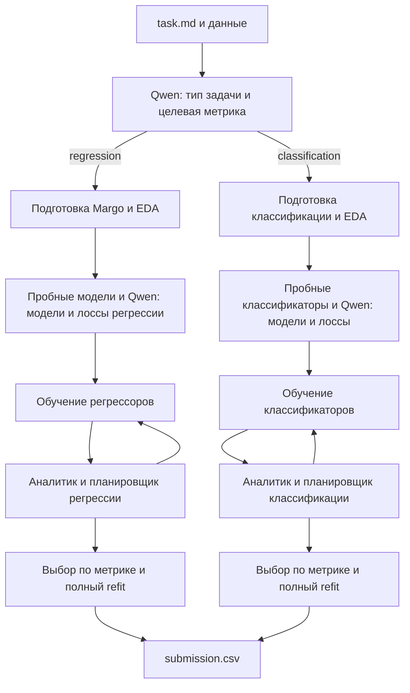

# Две линии одного решения

Единая точка входа: `python solution.py task.md`. Qwen определяет тип задачи и интерфейс по условию и заголовкам CSV. Затем `agent/platform_pipeline.py` явно выбирает одну из двух независимых линий:



Общими остаются протокол JSON, координатор таймера, аудит артефактов и интерфейс запуска. Регрессоры и классификаторы не подменяют друг друга. Первичная метрика фиксирована заданием.

Классификация выполняет подготовку и стратифицированный внешний split до EDA, короткие реальные пробы исключительно внутри outer-fit, затем отдельный вызов Qwen для выбора классификаторов и нативных функций потерь. Преобразования обучаются внутри каждого fold. Аналитик получает метрики и диагностику отдельных классов; планировщик меняет параметры выбранных моделей. Таймер и детерминированный координатор сохраняют лучшую модель и резерв времени для полного refit.

Поддерживаются бинарные и многоклассовые метки. Метрики: accuracy, balanced_accuracy, f1_macro, f1_weighted, binary f1, roc_auc и log_loss. Для log_loss направление — минимум, для остальных — максимум. Столбцы predict_proba выравниваются по зафиксированному порядку классов. CSV может содержать исходные метки или один столбец вероятности положительного класса в бинарной задаче. Многоклассовый CSV с отдельным столбцом вероятности на каждый класс пока не поддержан.

Семейства: LogisticRegression, SGDClassifier, RandomForest/ExtraTrees, HistGradientBoosting, LightGBM, CatBoost, XGBoost, MLP, KNN; адаптеры FLAML и AutoGluon с разрешёнными backend. У AutoML финал использует выбранную модель без повторного поиска. Все библиотеки присутствуют в исходном requirements.txt, который не изменён.

Снимки подготовки/выбора регрессии включены в `vendor/`; отдельные соседние репозитории для сборки больше не нужны. Сборка содержит только корневые `.py` и requirements:

```powershell
uv run --locked python tools/build_submission_folder.py ../Кейс+инструкция/max_pipeline_submission --replace
```

ZIP не создаётся. Ключ передаётся OPENAI_API_KEY, endpoint — OPENAI_BASE_URL, модель — OPENAI_MODEL, как у организаторского baseline. Общий предел всей линии — 80 минут. Ключи, данные, виртуальное окружение и результаты прогонов не входят в сборку.
