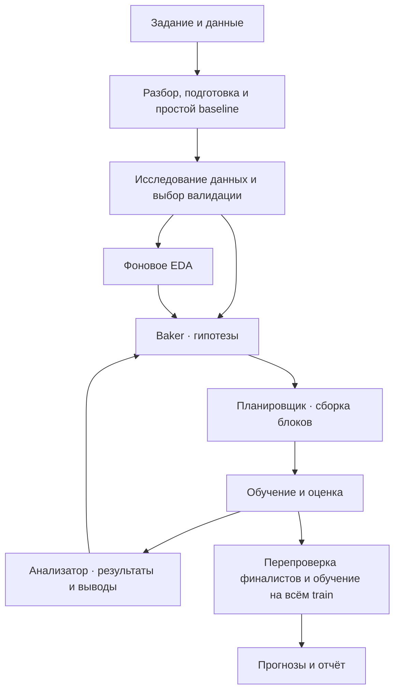

# BlocksTreeAR

Исследование данных и поиск ML-решений под управлением языковой модели.

Агент читает `task.md`, изучает данные и строит дерево экспериментов. Каждая гипотеза меняет часть решения: признаки, обработку, модель или объединение прогнозов. Удачные блоки переходят в следующие эксперименты. В конце агент выбирает финалиста и обучает его на всей доступной выборке.

**Python 3.12 · OpenAI-compatible API · FLAML · AutoGluon · Live monitoring**

[Запуск](#запуск) · [Архитектура](#архитектура) · [Настройки](#настройки-прогона) · [Мониторинг](#мониторинг) · [Результаты](#результаты)

## Возможности

| Направление | Инструменты |
| --- | --- |
| Исследование данных | Пропуски, распределения, сдвиги, связи между признаками, поиск ключей объектов и проверка гипотез небольшими моделями |
| Признаки | Выражения, частоты, групповые статистики, даты, история наблюдений, лаги и target encoding |
| Подготовка | Заполнение пропусков, кодирование категорий, масштабирование, выбор признаков и PCA |
| Модели | Линейные модели, деревья, леса, ExtraTrees, SVM, ближайшие соседи, LightGBM, XGBoost и CatBoost |
| AutoML | FLAML и AutoGluon Tabular с выбором моделей, параметров и пространства поиска |
| Объединения | Усреднение, голосование, условные правила, stacking и gating |
| Оценка | Общее разбиение для экспериментов, дополнительные разбиения для финалистов и финальное обучение |

Основной сценарий — табличная регрессия и классификация. Есть отдельные пайплайны для нескольких таргетов, многометочной классификации, ранжирования, кластеризации и временных рядов. Возможности каждого маршрута описаны в [документации по типам задач](Info/TASK_PIPELINES.md).

## Запуск

### Установка

Потребуются Python 3.12 и [uv](https://docs.astral.sh/uv/).

```sh
git clone https://github.com/Slavaxexe/BlocksTreeAR.git
cd BlocksTreeAR
uv sync --frozen
```

Версии зависимостей закреплены в `uv.lock`.

### Подключение модели

Создайте `.env` по образцу `.env.example`. Укажите адрес OpenAI-совместимого Chat Completions API, ключ и идентификатор модели у выбранного провайдера:

```dotenv
OPENAI_API_KEY=your-api-key
OPENAI_BASE_URL=https://api.example.com/v1
OPENAI_MODEL=your-model-id

LLM_TIMEOUT_SECONDS=400
LLM_MAX_TOKENS=0
LLM_API_PROFILE=standard
LLM_TOOLS_ENABLED=true
```

`api.example.com` — пример адреса; замените его своим endpoint. Модель должна уметь следовать JSON-схеме, переданной в запросе. Function calling используется для поиска по справочнику библиотек; для моделей с текстовым API установите `LLM_TOOLS_ENABLED=false`.

Профиль `standard` использует настройки генерации провайдера. Для серверов Qwen с поддержкой `enable_thinking` доступен профиль `qwen`: Baker и анализатор запрашивают средний уровень reasoning. Подробности — в [настройках подключения](Info/connection.md).

Проверка конфигурации:

```sh
uv run --no-sync python -m agent check-config
```

### Задача

В `task.md` опишите данные, целевую переменную, метрику и формат результата. Пути к таблицам задаются относительно этого файла; дополнительные описания признаков и образец ответа также можно указать в задании.

Пример запуска на учебном датасете: 30 минут общего времени, 5 минут начального EDA, до 150 запросов к модели.

```sh
uv run --no-sync python solution.py data/practice/concrete_strength/task.md --time-budget 1800 --eda-seconds 300 --max-llm-calls 150 --unlimited-nodes
```

Для своей задачи замените путь к Markdown-файлу. Примеры разных задач собраны в [data/practice](data/practice/README.md).

## Архитектура



**Baker** выбирает гипотезы и родительские решения. **Планировщик** превращает гипотезу в изменения операций. **Исполнитель** собирает решение и считает метрику. **Анализатор** сопоставляет ожидаемый эффект с измеренным результатом и передаёт выводы в следующий шаг поиска.

Типичный эксперимент состоит из четырёх блоков:

```text
features → preprocess → fit → predict
```

У каждого сохранённого решения есть идентификатор. Новая нода наследует его настройки и применяет указанные изменения. Можно добавлять признаки, менять модель, собирать ансамбли из сохранённых прогнозов и переиспользовать выбранную AutoML-конфигурацию.

EDA и модельные эксперименты выполняются готовыми Python-операциями по JSON-плану. При подготовке задачи языковая модель создаёт код загрузки данных, вычисления метрики и записи результата. Ошибки исполнения возвращаются на исправление в ту же ноду.

## Настройки прогона

Время указывается в секундах. Все этапы входят в общий бюджет: подготовка, исследования, эксперименты, перепроверка и финальное обучение.

| Параметр | Назначение | По умолчанию |
| --- | --- | --- |
| `--time-budget` | Общее время | 600 |
| `--eda-seconds` | Начальное исследование данных | 15% общего времени |
| `--experiment-timeout` | Один запуск эксперимента | 240 |
| `--parallel` | Одновременные модельные ноды | 6 |
| `--research-parallel` | Одновременные исследования данных | 2 |
| `--parallel-agents` | Одновременные запросы к языковой модели | 8 |
| `--max-llm-calls` | Бюджет API-вызовов, включая повторы | 80 |
| `--max-experiments` | Число модельных нод | 10 |
| `--max-research-nodes` | Число исследовательских нод | 12 |
| `--final-refit-seconds` | Резерв на финальное обучение | 300 |

`--unlimited-nodes` передаёт управление числом экспериментов общему бюджету времени и запросов. `--max-llm-calls 0` задаёт запуск без отдельного ограничения числа вызовов. Для длительного EDA используйте `--research-unlimited` вместе с явным `--eda-seconds`.

В AutoML доступны выбор семейств моделей, параметры, пространство поиска и доля времени `budget_fraction`. Их задаёт планировщик для конкретной гипотезы. Разбиение и метрика остаются общими для всех модельных нод.

Полный список параметров:

```sh
uv run --no-sync python -m agent --help
```

## Мониторинг

Запустите просмотрщик во втором терминале:

```sh
uv run --no-sync python viewer.py artifacts --port 8765
```

Откройте **http://127.0.0.1:8765**. В интерфейсе доступны выбор прогона, дерево гипотез, состав блоков, исследования данных, оценки и ошибки. Обновление — каждые две секунды.

Для сохранения HTML-отчёта:

```sh
uv run --no-sync python viewer.py artifacts --export outputs/report.html
```

## Результаты

Каждый прогон сохраняется в отдельной папке `artifacts/`. Путь печатается в терминале; собственный каталог можно задать через `--output-dir`.

| Файл или каталог | Содержимое |
| --- | --- |
| `report.json` | Статус прогона, причина завершения и расход API |
| `best.json` | Выбранное решение, оценка и путь к прогнозам |
| `preparation.json`, `split.npz` | Подготовка данных и разбиение |
| `nodes/` | Конфигурации, сборки блоков, попытки исправления и результаты |
| `research/` | Измерения и выводы EDA |
| `final_validation/` | Проверка финалистов на дополнительных разбиениях |
| `final/` | Итоговое обучение и прогнозы |
| `llm/`, `events.jsonl` | История запросов и событий |

Прогноз сохраняется рядом с `task.md` в формате из описания задачи; для примеров в репозитории это `submission.csv`. Оценки в журнале относятся к локальной валидации. Статус обучения на всей выборке записывается отдельно в `final/refit.json`.

## Структура проекта

```text
agent/             Роли модели, EDA, ML-операции и управление экспериментами
Info/              Архитектура и описание инструментов
data/              Датасеты и примеры задач
evaluation/        Оценка на учебных задачах
tests/             Проверки контрактов и операций
solution.py        Запуск задачи
viewer.py          Мониторинг и HTML-отчёты
ml_reference*.py   Справочник API библиотек
pyproject.toml     Зависимости проекта
uv.lock            Зафиксированные версии
```

Подробнее: [подключение модели](Info/connection.md) · [архитектура](Info/architecture.md) · [операции](Info/operations.md) · [справочник](Info/ml_reference.md).
