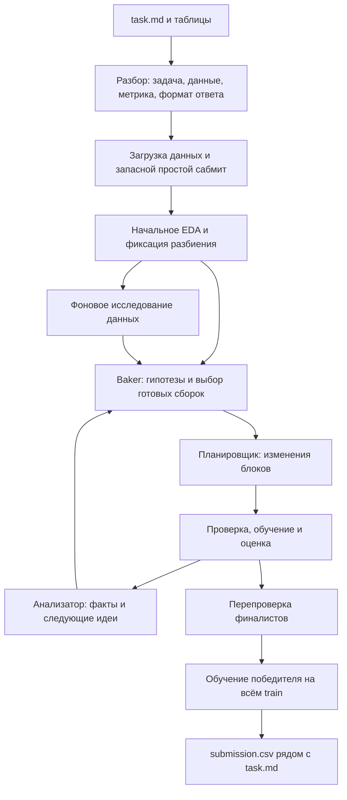

# Alfa AutoML

Автономный ML-агент для хакатона «Альфа Хак». Получает описание задачи в `task.md`, исследует данные, проверяет гипотезы и сохраняет `submission.csv`.

**Qwen выбирает стратегию, признаки и параметры. Python выполняет готовые операции, измеряет качество и сохраняет результат.** Эксперименты образуют дерево: удачные решения становятся основой следующих гипотез.

[Быстрый запуск](#быстрый-запуск) · [Как работает агент](#как-работает-агент) · [Мониторинг](#мониторинг) · [Сборка сабмита](#сборка-сабмита) · [Структура проекта](#структура-проекта)

## Быстрый запуск

Нужны **Python 3.12**, **uv** и доступ к OpenAI-совместимому API Qwen. Команды выполняются из корня проекта.

```sh
git clone https://github.com/Slavaxexe/AlfaHakaton.git
cd AlfaHakaton
uv sync --frozen
```

Зависимости закреплены в `pyproject.toml` и `uv.lock`. Полное окружение включает тяжёлые ML-библиотеки; доступность отдельных моделей зависит от установленных зависимостей и ОС.

### Подключение Qwen

Скопируйте `.env.example` в `.env` и заполните настройки. В PowerShell:

```powershell
Copy-Item .env.example .env
```

```dotenv
OPENAI_API_KEY=your_team_key
OPENAI_BASE_URL=https://changellenge.up.railway.app/v1
OPENAI_MODEL=qwen/qwen3.8-27b
QWEN_TIMEOUT_SECONDS=400
QWEN_MAX_TOKENS=0
```

Адрес и модель используйте из актуальной инструкции организаторов. Поддерживаются HTTP и HTTPS. Переменные окружения имеют приоритет над `.env`; ключ не нужно прописывать в исходниках. `.env` исключён из Git.

Проверка заполненности настроек **без обращения к модели**:

```sh
uv run --no-sync python -m agent check-config
```

`QWEN_TIMEOUT_SECONDS=0` отключает отдельный таймаут запроса, но сохраняет общий дедлайн прогона. Для локального запуска выше явно задано 400 секунд. `QWEN_MAX_TOKENS=0` означает отсутствие дополнительного ограничения со стороны клиента, а не отсутствие лимитов сервера.

### Первый прогон

Регрессия: 20 минут, до 100 API-вызовов, 3 минуты начального EDA. Число нод ограничивается временем и бюджетом запросов.

```sh
uv run --no-sync python solution.py data/regression/task.local.md --time-budget 1200 --eda-seconds 180 --experiment-timeout 600 --final-refit-seconds 180 --max-llm-calls 100 --unlimited-nodes --research-unlimited
```

Для классификации замените путь на `data/classification/task.local.md`. Для своей задачи передайте путь к её Markdown-файлу: пути к таблицам определяются из описания относительно каталога задания. Наличие `train.csv` непосредственно в этом каталоге не предполагается.

Прогон обращается к Qwen и расходует бюджет API. Дополнительные параметры:

```sh
uv run --no-sync python -m agent --help
```

## Как работает агент



1. **Разбор задания.** Четыре роли извлекают тип задачи, пути к данным, метрику и формат ответа. JSON проверяется локально, цитаты сверяются с исходным заданием.
2. **Подготовка.** Qwen создаёт загрузчик данных, scorer и writer. Разбиение выбирается декларативно и исполняется готовым кодом с сохранением исходных позиций строк. До основного поиска сохраняется дешёвый запасной прогноз.
3. **Исследование данных.** Готовые инструменты проверяют качество таблиц, сдвиги, связи, повторяемость объектов и полезность признаков на внутренней валидации. В модельный поиск передаются краткие выводы и идентификаторы готовых сборок.
4. **Поиск решений.** Baker предлагает гипотезу. Планировщик задаёт операции, а сборщик переиспользует неизменённые блоки. Результат сравнивается с родителем и лидером на общем внешнем разбиении.
5. **Обработка ошибок.** Ошибка конфигурации возвращается на исправление в ту же ноду. Повторы ограничены; ошибка отдельной ноды не удаляет уже полученный результат.
6. **Завершение.** Финалисты перепроверяются на дополнительных разбиениях. Выбранное решение дообучается на всём `train`, после чего прогноз сохраняется рядом с заданием. На эти этапы резервируется время внутри общего бюджета.

В EDA и модельных экспериментах Qwen формирует **конфигурации готовых инструментов**, а не произвольный Python-код. Генерация Python остаётся в подготовке данных и интерфейсе задачи.

### Блоки и модели

Типичная сборка: `features → preprocess → fit → predict`. AutoML и объединение сохранённых прогнозов могут выступать самостоятельными операциями.

| Часть решения | Возможности |
| --- | --- |
| Признаки | Арифметические выражения, частоты, групповые статистики, даты, история, лаги и target encoding с учётом разбиения |
| Предобработка | Пропуски, ordinal/one-hot/native категории, масштабирование, выбор и удаление столбцов, PCA |
| Обычные модели | Линейные модели, деревья и леса, ExtraTrees, бустинги sklearn, LightGBM, XGBoost, CatBoost, SVM, ближайшие соседи |
| AutoML | Адаптеры FLAML и AutoGluon Tabular: семейства моделей, параметры, пространства поиска, внутреннее разбиение и бюджет |
| Объединения | Усреднение, голосование, вероятности, условные правила, stacking и gating; переиспользование сохранённых прогнозов и выбранных моделей |

Готовая сборка имеет идентификатор. Изменения применяются только к явно указанным блокам и параметрам; остальные настройки наследуются. При смене семейства модели параметры старого конструктора не переносятся.

Кроме обычной регрессии и классификации, предусмотрены маршруты для нескольких таргетов, многометочной классификации, ранжирования, кластеризации и временных рядов. Возможности адаптеров различаются: например, AutoGluon Tabular не поддерживает ranking и нативное прогнозирование рядов. Условия и ограничения описаны в [типах пайплайнов](Info/TASK_PIPELINES.md).

Внешние validation/test-таргеты не служат источником признаков. Внутренний подбор и обучение объединений используют отдельные данные внутри `fit`. **Локальный validation score не является оценкой на скрытом тесте платформы.**

## Бюджеты и параллельность

Локальный CLI и собранный ZIP имеют разные настройки по умолчанию. Указанные в команде параметры переопределяют настройки CLI.

| Настройка | Локальный CLI без флагов | ZIP из `build_submission.py` |
| --- | --- | --- |
| Общий бюджет | 10 минут | **3 часа** |
| Начальное EDA | 15% общего времени | **10 минут** |
| Один полный запуск эксперимента | 4 минуты | **10 минут** |
| Модельные ноды одновременно | До 6: 5 улучшений + 1 исследование | До 6: 4 улучшения + 2 исследования |
| Фоновые исследования данных | До 2 | До 2 |
| Одновременные запросы Qwen | До 8 | До 8 |
| API-вызовы | 80 | Без отдельного лимита числа вызовов |
| Число нод | 10 модельных, 12 исследовательских | Без отдельного лимита числа нод |
| Таймаут запроса Qwen | Из `.env` / окружения | 400 секунд |

Это верхние пределы, а не обязательное число работающих нод. На старте поиск использует меньше слотов; реальная параллельность зависит от готовых гипотез, API и оставшегося времени.

Один AutoML не получает весь бюджет прогона. Worker оставляет часть времени на прогноз и сохранение: при лимите эксперимента 600 секунд обучение получает до 480 секунд. `budget_fraction` позволяет Qwen уменьшить доступную долю; внутренний поиск также оставляет запас на дообучение. Внешний таймаут останавливает затянувшийся процесс. Исправление и повторный запуск могут увеличить суммарное время ноды, но остаются в общем бюджете.

`--max-llm-calls 0` убирает лимит числа запросов. `--unlimited-nodes` убирает лимиты числа нод. При `--research-unlimited` задавайте `--eda-seconds` явно: без явного окна начальное EDA может занять всё доступное поиску время.

## Мониторинг

Во втором терминале, из корня проекта:

```sh
uv run --no-sync python viewer.py artifacts --port 8765
```

Откройте **http://127.0.0.1:8765**. Мониторинг показывает разбор задания, дерево экспериментов, сборки блоков, исследования данных, метрики и ошибки. Выбор прогона находится в интерфейсе; данные обновляются каждые две секунды. Сервер слушает только локальный адрес.

Можно передать несколько каталогов запусков или сохранить самостоятельный HTML-снимок:

```sh
uv run --no-sync python viewer.py artifacts --export outputs/monitoring.html
```

### Где искать результат

Каждый запуск создаёт отдельную папку в `artifacts/`. Её путь печатается после завершения; его также можно задать через `--output-dir`.

| Файл / каталог | Содержимое |
| --- | --- |
| `report.json` | Итоговый статус, причина остановки, предупреждения и расход вызовов |
| `best.json` | Победитель, оценка и путь к выбранному сабмиту |
| `preparation.json`, `split.npz` | Подготовка и зафиксированные позиции строк |
| `nodes/node_*/` | Конфигурация, сборка, попытки исправления, диагностика и результат эксперимента |
| `research/` | Запросы EDA, измерения и выводы |
| `llm/`, `events.jsonl` | Запросы, ответы и события для отладки |
| `final_validation/` | Перепроверка финалистов |
| `final/refit.json`, `final/submission.csv` | Статус и результат финального дообучения, если оно завершилось |

Файл для платформы — **`submission.csv` в каталоге переданного `task.md`**. Статус финального дообучения нужно смотреть отдельно: оценка в `best.json` относится к валидации до обучения на всём `train`.

## Сборка сабмита

```sh
uv run --no-sync python build_submission.py --output submission.zip
```

Сборщик создаёт **плоский ZIP**: `solution.py`, дополнительные `.py`-модули и предоставленный организаторами `requirements.txt` лежат в корне. Источник зависимостей для архива — [`baseline/requirements_data.txt`](baseline/requirements_data.txt). Датасеты, `.env`, тесты и артефакты в архив не попадают. Существующий ZIP не перезаписывается: выберите новое имя.

На платформе точка входа:

```sh
python solution.py /path/to/task.md
```

В собранном архиве адрес и ключ читаются **только** из `OPENAI_BASE_URL` и `OPENAI_API_KEY`, имя модели — из `OPENAI_MODEL` с резервным значением `qwen/qwen3.8-27b`. Поддерживаются HTTP и HTTPS. Платформа должна предоставить необходимые зависимости и переменные окружения.

Общий бюджет собранной версии можно переопределить при запуске, например `--time-budget 7200` для двух часов. Начальное EDA останется десятиминутным. Это интерфейс архивной точки входа; локальные дополнительные флаги CLI в неё не переносятся.

## Структура проекта

```text
agent/                Роли Qwen, планирование, инструменты EDA и ML, исполнение
baseline/             Исходный baseline и зависимости организаторов
Info/                 Условие, описание архитектуры и интерфейсов
data/                 Публичные датасеты и дополнительные учебные задачи
evaluation/           Локальная оценка учебных задач
tests/                Проверки контрактов, операций и исправленных ошибок
schemas/              Схемы артефактов
solution.py           Локальная точка входа
viewer.py             Мониторинг запусков
build_submission.py   Сборка плоского ZIP для платформы
ml_reference*.py      Справочник API библиотек и поиск по нему
pyproject.toml        Локальные зависимости
uv.lock               Зафиксированное окружение
```

Артефакты, локальные ключи, логи и ZIP-архивы не входят в исходники. Полезные документы: [условие кейса](Info/task.md), [данные](Info/datasets.md), [готовые операции](Info/operations.md), [типы задач](Info/TASK_PIPELINES.md), [справочник библиотек](Info/ml_reference.md). Точные текущие флаги доступны через `python -m agent --help`.
